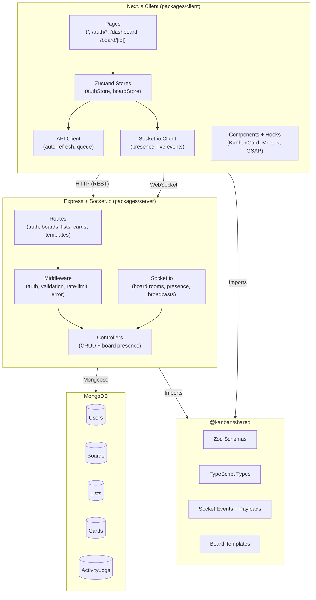
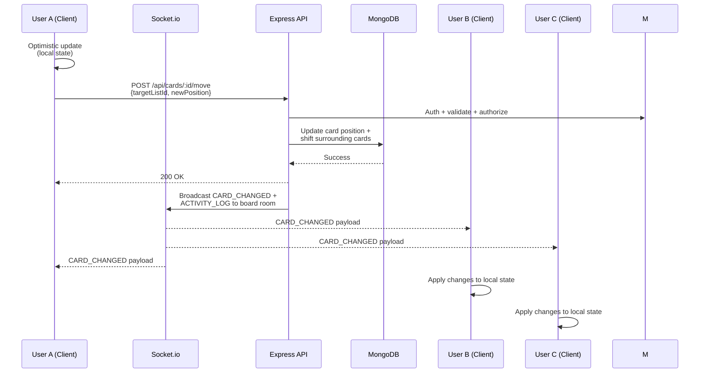

# Flowboard — Kanban for Teams


**Flowboard** is a collaborative, real-time kanban board application designed for teams who want a clean, fast, and visually calm project management experience. It solves the problem of keeping distributed team members aligned on task progress by providing instant card updates, presence awareness, and a rich activity log — all without the noise of traditional project management tools. Built for developers, designers, and agile teams that value both speed and polish.

---

## Tech Stack

| Category | Technology | Version |
|---|---|---|
| **Language** | TypeScript | ^5.9.3 |
| **Frontend Framework** | Next.js | ^15.5.22 |
| **UI Library** | React | ^18.3.1 |
| **Styling** | Tailwind CSS | ^3.4.1 |
| **State Management** | Zustand | ^4.5.0 |
| **Animation** | GSAP / @gsap/react | ^3.13.0 / ^2.1.2 |
| **Validation** | Zod | ^3.22.4 |
| **Backend Framework** | Express | ^4.18.2 |
| **Database** | MongoDB via Mongoose | ^8.1.1 |
| **Auth** | bcryptjs + jsonwebtoken | ^2.4.3 / ^9.0.2 |
| **Real-time** | Socket.io / socket.io-client | ^4.7.4 |
| **Security** | Helmet, CORS, express-rate-limit | ^7.1.0 / ^2.8.5 / ^7.1.5 |
| **Dev Tooling** | concurrently, tsx, ts-jest | ^8.2.2 / ^4.7.0 / ^29.1.1 |
| **Testing** | Jest, Testing Library, Supertest | ^29.7.0 / ^6.4.0 / ^6.3.4 |

---

## File Structure

```
kanban-board/
├── .gitignore
├── package.json                  # Monorepo root — npm workspaces, shared scripts
├── tsconfig.json                 # Shared TypeScript config (ES2022, bundler)
├── README.md
│
├── packages/
│   ├── shared/                   # Shared between client & server
│   │   ├── package.json
│   │   └── src/
│   │       ├── index.ts          # Re-exports all shared modules
│   │       ├── schemas.ts        # Zod validation schemas + inferred types
│   │       ├── types.ts          # TokenPayload, ApiError, ApiResponse
│   │       ├── events.ts         # Socket.io event enums + payload interfaces
│   │       └── templates.ts      # Pre-built board templates (6 included)
│   │
│   ├── server/                   # Express API + WebSocket server
│   │   ├── package.json
│   │   └── src/
│   │       ├── index.ts          # Entry — connects MongoDB, starts HTTP + Socket.io
│   │       ├── app.ts            # Express app factory (routes, middleware)
│   │       ├── config/
│   │       │   └── env.ts        # Environment config + production secret guard
│   │       ├── middleware/
│   │       │   ├── auth.ts       # JWT Bearer token authentication
│   │       │   ├── validate.ts   # Zod schema validation middleware
│   │       │   └── errorHandler.ts  # Unified error handling (AppError, ZodError, etc.)
│   │       ├── models/
│   │       │   ├── User.ts       # User schema (bcrypt hashing, comparePassword)
│   │       │   ├── Board.ts      # Board schema (owner + members)
│   │       │   ├── List.ts       # List schema (positioned within board)
│   │       │   ├── Card.ts       # Card schema (priority, labels, due dates)
│   │       │   ├── ActivityLog.ts # Immutable activity log entries
│   │       │   └── index.ts      # Re-exports all models
│   │       ├── controllers/
│   │       │   ├── authController.ts   # register, login, refresh, logout, getMe
│   │       │   ├── boardController.ts  # CRUD + getTemplates
│   │       │   ├── listController.ts   # CRUD with real-time broadcasts
│   │       │   └── cardController.ts   # CRUD + move (cross-list reorder)
│   │       ├── routes/
│   │       │   ├── authRoutes.ts       # /api/auth — rate-limited
│   │       │   ├── boardRoutes.ts      # /api/boards
│   │       │   ├── listRoutes.ts       # /api/lists
│   │       │   ├── cardRoutes.ts       # /api/cards
│   │       │   └── templateRoutes.ts   # /api/templates
│   │       ├── socket/
│   │       │   └── index.ts      # Socket.io setup — auth, presence, board rooms
│   │       └── utils/
│   │           └── reorder.ts    # Pure function for card position math
│   │
│   └── client/                   # Next.js 15 frontend (App Router)
│       ├── package.json
│       └── src/
│           ├── app/
│           │   ├── layout.tsx    # Root layout — Plus_Jakarta_Sans font, globals.css
│           │   ├── page.tsx      # Landing — redirects to /dashboard or /auth/login
│           │   ├── globals.css   # Tailwind directives + component classes
│           │   ├── auth/
│           │   │   ├── login/
│           │   │   │   └── page.tsx    # Login form with error animation
│           │   │   └── register/
│           │   │       └── page.tsx    # Registration form
│           │   ├── dashboard/
│           │   │   └── page.tsx        # Board listing, search, quick-create
│           │   └── board/
│           │       └── [id]/
│           │           └── page.tsx    # Live kanban board view
│           ├── components/
│           │   ├── board/
│           │   │   ├── KanbanCard.tsx        # Draggable card with priority/labels
│           │   │   ├── CardDetailModal.tsx   # Full card editor modal
│           │   │   ├── ActivitySidebar.tsx   # Slide-out activity feed
│           │   │   └── CreateBoardModal.tsx  # Board creation with template picker
│           │   ├── layout/
│           │   │   └── AppHeader.tsx    # Sticky header with user menu + back nav
│           │   └── ui/
│           │       ├── Modal.tsx        # Reusable accessible modal
│           │       ├── AnimatedPanel.tsx # GSAP enter/exit wrapper
│           │       └── Skeleton.tsx     # Loading skeleton components
│           ├── hooks/
│           │   └── animations/
│           │       ├── useBoardEntrance.ts   # Staggered column/card entrance
│           │       ├── useFlipCards.ts        # FLIP animation on card layout changes
│           │       ├── useErrorReveal.ts      # Error message entrance
│           │       ├── useExitAnimation.ts    # Element exit before unmount
│           │       ├── useReducedMotion.ts    # Respects prefers-reduced-motion
│           │       └── useRevealForm.ts       # Form reveal animation
│           ├── lib/
│           │   ├── api.ts          # Fetch wrapper with auto token refresh
│           │   ├── socket.ts       # Socket.io client singleton
│           │   ├── reorder.ts      # Drop position calculation
│           │   ├── theme.ts        # Color styles, priority styles, date formatters
│           │   └── gsap/
│           │       ├── registerPlugins.ts  # GSAP plugin registration
│           │       └── reducedMotion.ts    # Media query constant
│           └── store/
│               ├── authStore.ts    # Zustand — auth state + actions
│               └── boardStore.ts   # Zustand — board data + socket event handlers
```

---

## Features

### Authentication & User Management
- **Register / Login** — Email + password with bcrypt-hashed passwords (12 salt rounds)
- **JWT Token Pair** — Short-lived access token (15 min) + long-lived refresh token (7 days)
- **Silent Refresh** — Automatic token rotation on 401 responses; queued retries prevent race conditions
- **Session Persistence** — Tokens stored in `localStorage`, restored on page reload

### Board Management
- **CRUD Boards** — Create, read, update (title, description, color), and delete
- **Owner Controls** — Only board owners can update or delete a board
- **Pagination** — Paginated board listing (default 50 per page, sorted by `updatedAt`)
- **Board Colors** — 6 accent colors (lavender, sage, peach, sky, rose, sand)

### Board Templates
- **6 Pre-built Templates** — Blank, Basic Kanban, Scrum Sprint, Content Calendar, Bug Tracker, Personal Tasks
- **Seed on Create** — Selecting a template creates its lists and sample cards in a single request
- **Template Preview** — Visual template picker with column preview in the create modal

### List Management
- **CRUD Lists** — Add/rename/delete columns on any board
- **Positioned Ordering** — Lists stored with explicit position field for drag-to-reorder

### Card Management
- **CRUD Cards** — Add, edit, delete cards with rich metadata
- **Drag & Drop** — Native HTML5 drag and drop with visual drop indicators
- **Cross-List Moves** — Move cards between lists with automatic position gap-filling
- **Priority Levels** — None / Low / Medium / High — color-coded badges
- **Labels** — Predefined labels: Bug, Feature, Design, Planning, Blog, Social, Urgent
- **Due Dates** — Date picker with relative display ("Due today", "Overdue", etc.)
- **Card Detail Modal** — Full inline editor for all card fields
- **Search** — Real-time card filtering across title, description, and labels

### Real-Time Collaboration
- **Socket.io Rooms** — Each board is a Socket.io room; clients join on page load
- **Presence Tracking** — See who else is viewing the board (avatar stack with count)
- **Live Updates** — Card moves, edits, and deletes broadcast to all room members instantly
- **Rebounce on Reconnect** — Auto re-join board + full REST re-sync on socket reconnection
- **Connection Status** — Visual badge: connected / reconnecting / disconnected

### Activity Log
- **Immutable Feed** — Every create, update, delete, and move action is logged
- **Scoped to Board** — Last 50 activity entries per board, sorted newest-first
- **Slide-Out Sidebar** — Activity feed opens as a right-side panel with relative timestamps

### Animations & UX
- **Staggered Entrance** — Columns and cards animate in sequence when the board loads
- **FLIP Animations** — Cards smoothly transition to new positions after moves
- **Enter / Exit Tweens** — New list/card inputs and card deletions animate with GSAP
- **Reduced Motion** — All animations respect the `prefers-reduced-motion` media query
- **Skeleton Loading** — Dashboard and board views show animated skeleton placeholders
- **Custom Scrollbars** — Thin, theme-aware scrollbars throughout

### Security
- **Helmet** — HTTP security headers
- **CORS** — Strict origin whitelist per environment
- **Rate Limiting** — Separate rate limiters for auth (20/15min), boards (30/min), lists (30/min), cards (60/min)
- **Production Secret Guard** — Refuses to boot in production with default JWT secrets
- **Password Security** — Minimum 8 characters, bcrypt hashing, never returned in API responses

---

## Architecture / Workflow



**Explanation:** The client integrates both REST and WebSocket connections to the server. On initial board load, the full board state (board metadata, lists, cards, activity log) is fetched via REST. The client then opens a Socket.io connection and joins the board's room. All subsequent changes (card moves, edits, deletes) are performed via REST for persistence, while the server broadcasts those changes to all connected clients in the same room over WebSocket. The shared `@kanban/shared` package ensures type safety and schema consistency across the stack. Presence tracking (who's viewing the board) is handled entirely over WebSocket.

### Request Lifecycle: Moving a Card



---

## Setup / Installation

### Prerequisites

- **Node.js** >= 18.0.0
- **MongoDB** running locally (or a remote instance)
- **npm** (comes with Node)

### 1. Clone & Install

```bash
cd kanban-board
npm install
```

This installs dependencies for all three packages (`packages/client`, `packages/server`, `packages/shared`) via npm workspaces.

### 2. Environment Variables

The server accepts the following environment variables. Defaults work for local development.

| Variable | Default | Description |
|---|---|---|
| `PORT` | `4000` | Server listen port |
| `MONGODB_URI` | `mongodb://localhost:27017/kanban` | MongoDB connection string |
| `JWT_SECRET` | `dev-jwt-secret-change-in-production` | JWT signing secret |
| `JWT_REFRESH_SECRET` | `dev-refresh-secret-change-in-production` | Refresh token secret |
| `CORS_ORIGIN` | `http://localhost:3000` | Allowed CORS origin |
| `NODE_ENV` | `development` | Environment mode |

Create a `.env` file in `packages/server/` if you want to override defaults.

### 3. Run in Development

```bash
npm run dev
```

This uses `concurrently` to start both the server and client:

- **Server** → `http://localhost:4000` (via `tsx watch`)
- **Client** → `http://localhost:3000` (via `next dev`)

### 4. Build for Production

```bash
npm run build
```

Compiles the shared package first (TypeScript → CommonJS), then builds the server and client.

### 5. Start Production Server

```bash
# After building
npm run start -w packages/server
```

The client is served via Next.js separately (`npm run start -w packages/client`).

### 6. Run Tests

```bash
npm test
```

Runs Jest in both `packages/server` and `packages/client`.

### 7. Lint & Type-Check

```bash
npm run lint       # ESLint on both packages
npm run typecheck  # tsc --noEmit on all packages
npm run ci         # lint + typecheck + test
```

---

## Other Notes

### Known Limitations

- **Single-User Lists** — Lists don't currently support drag-to-reorder within the UI (position is set on creation). This can be added via the existing `updateList` API.
- **No Board Invite Flow** — Users are added to boards as members only by the owner directly via the API; there is no email invitation system.
- **No File Attachments** — Cards support labels and descriptions but not file uploads or image attachments.
- **No Notifications** — Real-time updates are in-app only; there's no push notification or email alert system.
- **No Offline Mode** — The app requires a persistent network connection; there is no offline queue or PWA support.

### Deployment

- **Frontend:** The Next.js client can be deployed to Vercel, Netlify, or any Node.js host. Set `NEXT_PUBLIC_API_URL` to the server's URL.
- **Backend:** The Express + Socket.io server can be deployed to platforms like Railway, Render, Fly.io, or any VPS. Ensure WebSocket support is enabled (some platforms require sticky sessions or a custom adapter like `@socket.io/redis-adapter` for multi-instance deployments).
- **Database:** MongoDB Atlas is the recommended production database.
- **Secrets:** **Always** set `JWT_SECRET` and `JWT_REFRESH_SECRET` to strong, unique values in production. The app will refuse to start if it detects default secrets in production mode.

### Testing Approach

- **Backend:** Unit tests for the reorder utility (`utils/reorder.ts`), integration tests for API endpoints using Supertest. The `app.ts` is kept separate from `index.ts` so the Express app can be imported in tests without starting the server.
- **Frontend:** Component tests with Jest + Testing Library. Tests are configured with `ts-jest` and `jest-environment-jsdom`.
- **Shared:** TypeScript type-checking ensures schema consistency between client and server.

### Project Structure Philosophy

This project uses a **monorepo** with three packages:

1. **`@kanban/shared`** — Zero-runtime-dependency package containing only TypeScript types, Zod schemas, socket event definitions, and template data. This is the contract between client and server.
2. **`@kanban/server`** — Fat model, thin controller pattern. Business logic lives in Mongoose model hooks (e.g., password hashing) and pure utility functions (e.g., `planCardMove`). Controllers handle request/response and delegate to models.
3. **`@kanban/client`** — Pages use the App Router layout system. State is managed with Zustand stores. Socket event listeners are registered once in the board store rather than per-component, preventing duplicate handler registrations.