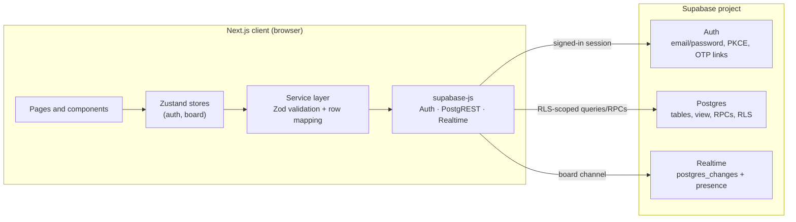

# Flowboard

Flowboard is a collaborative kanban app built as a **single Next.js 15 client** that talks directly to **Supabase** for authentication, Postgres storage, Row Level Security, and Realtime updates. There is no custom API server, no privileged server code, and no MongoDB or Socket.io layer.

The browser holds only the Supabase project URL and a **publishable / anon** key. Every read and write runs as the signed-in user and is enforced by Postgres RLS.

## Verification snapshot

Verified on **2026-10-26** after the folder restructure:

| Check | Command | Result |
|---|---|---|
| TypeScript | `npm run typecheck` | Pass |
| ESLint | `npm run lint` | Pass, 0 warnings |
| Unit / component tests | `npm test` | 6 suites, 74 tests pass |
| RLS policies (PGlite) | `npm run test:rls` | 45 checks pass |
| Production build | `npm run build` | Pass, 9 routes |

The RLS suite applies the real migrations to PGlite with simulated JWT claims. It validates policy logic but is not a substitute for a hosted smoke test.

Hosted status: `.env.local` points at the supplied Supabase project and the browser reaches its Auth API with the publishable key. The hosted public schema still needs the migrations in `supabase/migrations/` applied, and email confirmation is enabled, so hosted board CRUD, invitations, and two-browser Realtime remain pending until then. See [docs/database.md](docs/database.md) and [docs/deployment.md](docs/deployment.md).

## Tech stack

| Area | Technology |
|---|---|
| Framework | Next.js 15 App Router, React 18, TypeScript 5 |
| Styling | Tailwind CSS 3, custom design tokens, Plus Jakarta Sans |
| State | Zustand 4 |
| Validation | Zod 3 (forms, services, typed DTOs) |
| Data and auth | `@supabase/supabase-js` 2.118 — Auth (PKCE), Postgres, Realtime |
| Animations | GSAP, `@gsap/react`, reduced-motion support |
| Icons | lucide-react |
| Tests | Jest, ts-jest, Testing Library, PGlite |

## Architecture



- **Pages** are client components; dashboard and board data load after the auth session is restored.
- **Stores** own UI state, optimistic mutations, rollback, and Realtime subscriptions.
- **Services** are the only place that calls Supabase. They validate input, map snake_case rows to domain types, and translate errors.
- **RLS is the security boundary.** Hiding a button is UX, not authorization.

Full layering rules and the data flow are in [docs/architecture.md](docs/architecture.md).

## Project structure

```text
.
├── .github/workflows/ci.yml        # lint, typecheck, Jest, RLS, production build
├── docs/                           # architecture, database, testing, deployment
├── supabase/migrations/
│   ├── 20261026000100_schema.sql   # tables, constraints, indexes, board_overview
│   ├── 20261026000200_rls.sql      # grants and RLS policies
│   ├── 20261026000300_functions.sql# atomic board creation, card move, list reorder, invite
│   ├── 20261026000400_realtime.sql # replica identity + realtime publication
│   └── 20261026000500_backfill_profiles.sql # profiles for pre-trigger auth users
├── src/
│   ├── app/                        # routes only (no src/app/api)
│   │   ├── page.tsx                # redirects by session state
│   │   ├── layout.tsx              # metadata, AuthProvider, toasts
│   │   ├── auth/                   # login, register, forgot/reset password, callback
│   │   ├── dashboard/              # portfolio stats, filters, templates, board management
│   │   └── board/[id]/             # live board: lists, cards, members, activity
│   ├── components/
│   │   ├── auth/                   # AuthShell, forms, RequireAuth
│   │   ├── board/                  # board header, columns, cards, detail/member/settings modals
│   │   ├── dashboard/              # stats, priority mix, templates, board cards, filters, deadlines
│   │   ├── layout/                 # AppHeader, brand, user menu, profile settings, setup notice
│   │   ├── providers/              # AuthProvider bootstrap
│   │   └── ui/                     # Button, Field, Modal, Drawer, Popover, Toast, Skeleton, etc.
│   ├── config/                     # theme tokens and board seed templates
│   ├── hooks/
│   │   ├── animations/             # board entrance, FLIP cards, reduced motion
│   │   ├── auth/                   # redirect-if-authenticated
│   │   └── ui/                     # useDialogA11y: focus trap, stacking, scroll lock
│   ├── lib/
│   │   ├── supabase/               # env access and browser singleton
│   │   ├── errors.ts               # user-safe error mapping
│   │   ├── validation.ts           # shared Zod schemas
│   │   ├── reorder.ts              # pure drag/drop position math
│   │   ├── dates.ts, navigation.ts, scrollLock.ts, utils.ts, gsap.ts
│   ├── services/                   # auth, dashboard, boards, lists, cards, activity + mappers/postgrest
│   ├── stores/                     # authStore, boardStore (optimistic + realtime)
│   └── types/                      # database rows, domain model, global declarations
├── tests/
│   ├── unit/                       # stores, lib, services
│   ├── component/                  # Testing Library suites
│   ├── rls/verify-rls.mjs          # PGlite harness applying the real migrations
│   └── setup/                      # Jest setup and style mock
├── .env.example
├── jest.config.js
├── next.config.js
├── tailwind.config.js
├── tsconfig.json
└── tsconfig.test.json              # JSX transform for Jest only
```

There is no `src/app/api` directory: the app is client-only and calls Supabase directly. There is no `public/` directory; icons are inline SVG or lucide components.

## Quick start

### 1. Install

```bash
npm install
```

### 2. Configure Supabase

Create a project at [database.new](https://database.new), then apply the migrations **in filename order** in the Supabase SQL editor (or `supabase link` + `supabase db push`). Details, including Auth URL configuration and Realtime setup, are in [docs/database.md](docs/database.md).

### 3. Environment

```bash
cp .env.example .env.local
```

```dotenv
NEXT_PUBLIC_SUPABASE_URL=https://your-project-ref.supabase.co
NEXT_PUBLIC_SUPABASE_PUBLISHABLE_KEY=sb_publishable_xxx
NEXT_PUBLIC_APP_URL=http://localhost:3000
```

Set exactly one of `NEXT_PUBLIC_SUPABASE_PUBLISHABLE_KEY` or the legacy `NEXT_PUBLIC_SUPABASE_ANON_KEY`. There are no server-only secrets and no `service_role` key.

### 4. Run

```bash
npm run dev
```

Register an account, create a board, and invite a second registered account to test collaboration.

## Scripts

| Command | Purpose |
|---|---|
| `npm run dev` | Development server |
| `npm run build` | Production build |
| `npm run start` | Serve the production build |
| `npm run lint` | `next lint` |
| `npm run typecheck` | `tsc --noEmit` |
| `npm test` | Jest unit and component suites |
| `npm run test:rls` | Apply migrations to PGlite and assert RLS behavior |
| `npm run verify` | Typecheck, lint, Jest, RLS, and build in order |

## Documentation

| Document | Contents |
|---|---|
| [docs/architecture.md](docs/architecture.md) | Layers, dependency rules, data flow, feature map |
| [docs/database.md](docs/database.md) | Supabase setup, migrations, data model, RPCs, security, mock-data policy |
| [docs/testing.md](docs/testing.md) | Test layout, commands, coverage, and how to add tests |
| [docs/deployment.md](docs/deployment.md) | Deploy steps, production checklist, and known limitations |

## Security model

- **No privileged client code.** The browser uses only the publishable/anon key. All privileged behavior is expressed in Postgres RLS and narrowly scoped RPCs.
- **RLS on every public table.** Access derives from `auth.uid()`, board ownership, or `board_members`.
- **Private helpers.** `private.is_board_member`, `private.is_board_owner`, and `private.shares_board_with` are `SECURITY DEFINER`, pin `search_path`, revoke `public`/`anon`, and grant execute to `authenticated` only.
- **Owner controls.** Only owners can update/delete a board, invite members, or remove other members. Members can leave themselves.
- **View safety.** `board_overview` uses `security_invoker = true`, so a view cannot bypass RLS.
- **Error handling.** Internal Postgres messages are mapped to safe user-facing messages.

## Mock data policy

There is no mock data layer and no demo mode. Every board, list, card, member, and activity entry shown while configured is read from Supabase. The six templates are deterministic **seed definitions**: creating a board writes their content into the live database as real rows. When Supabase is not configured, the UI displays setup instructions instead of pretending to load data.
