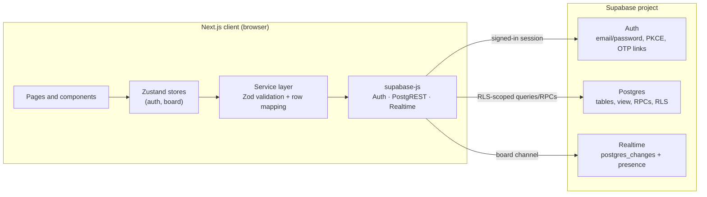
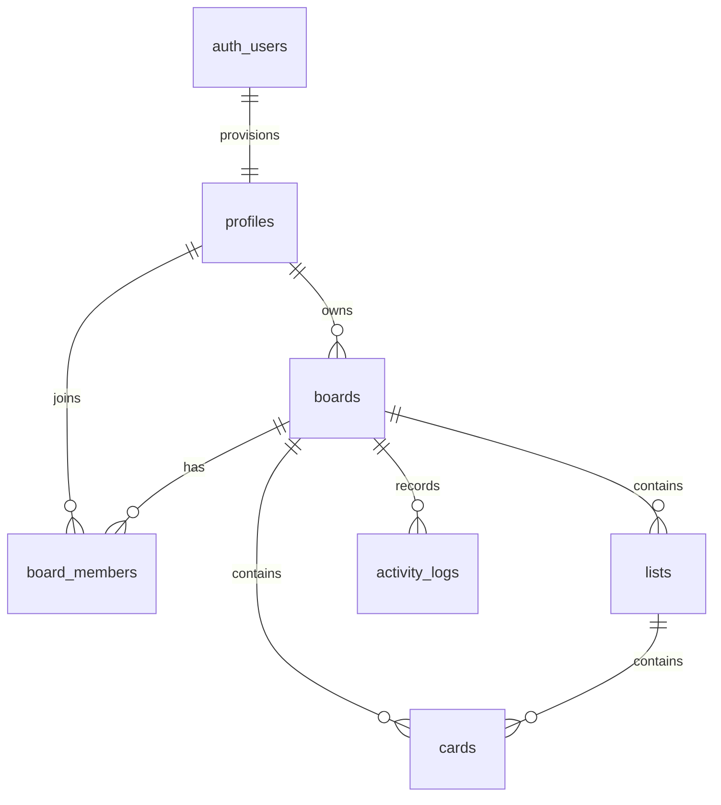

# Flowboard

Flowboard is a collaborative kanban app built as a **single Next.js 15 client** that talks directly to **Supabase** for authentication, Postgres storage, Row Level Security, and Realtime updates. There is no custom API server, no privileged server code, and no MongoDB or Socket.io layer.

The browser holds only the Supabase project URL and a **publishable / anon** key. Every read and write runs as the signed-in user and is enforced by Postgres RLS.

## Verification snapshot

Verified on **2026-10-26**:

| Check | Command | Result |
|---|---|---|
| TypeScript | `npm run typecheck` | Pass |
| ESLint | `npm run lint` | Pass, 0 warnings |
| Unit / component tests | `npm test` | 6 suites, 71 tests pass |
| RLS policies (PGlite) | `npm run test:rls` | 43 checks pass |
| Production build | `npm run build` | Pass, 10 routes |
| Browser smoke test | `/auth/login`, `/auth/register`, `/dashboard` | Setup notice gone; forms render; client validation and auth guard work; no unexpected console errors (the invalid-login 400 is handled) |
| Hosted Auth connectivity | Hosted `POST /auth/v1/token` | Publishable key accepted; invalid credentials show "Incorrect email or password." |
| Hosted database schema | Hosted `GET /rest/v1/boards` | **Blocked:** `PGRST205`; migrations have not been applied to the hosted project |
| Hosted Auth readiness | Hosted `/auth/v1/settings` | Email signup enabled, but confirmation is required (`mailer_autoconfirm=false`) |

**Hosted verification status (2026-10-26):** `.env.local` is configured for the supplied Supabase project, and the browser reaches its Auth API with the publishable key. The hosted public schema is still empty, and email confirmation is enabled, so authenticated dashboard/board CRUD, invitations, password recovery, two-browser Realtime/presence, and hosted-JWT RLS remain pending until the migrations are applied and a test account is confirmed. The local suites below still cover the data layer and policy logic against the real migrations.

To unblock hosted verification:

1. Run the five files in `supabase/migrations/` in order in the Supabase SQL editor.
2. Add `http://localhost:3000/auth/callback` to **Authentication → URL Configuration → Redirect URLs** and set the Site URL.
3. Create a test account and confirm its email, or temporarily disable **Confirm email** while testing.
4. Repeat the sign-up, login, dashboard, board, invite, and two-browser Realtime checks.

The RLS suite applies the real migrations to PGlite with simulated JWT claims, which validates policy logic but is not a substitute for a hosted smoke test.

## Tech stack

| Area | Technology |
|---|---|
| Framework | Next.js 15 App Router, React 18, TypeScript 5 |
| Styling | Tailwind CSS 3, custom design tokens, Plus Jakarta Sans |
| State | Zustand 4 |
| Validation | Zod 3 (forms, services, typed DTOs) |
| Data and auth | `@supabase/supabase-js` 2.118 — Auth (PKCE), Postgres, Realtime |
| Animations | GSAP, `@gsap/react`, reduced-motion support |
| Icons | lucide-react |
| Tests | Jest, ts-jest, Testing Library, PGlite |

## Architecture



- **Pages** are client components; dashboard and board data are loaded after the auth session is restored.
- **Stores** own UI state, optimistic mutations, rollback, and Realtime subscriptions.
- **Services** are the only place that calls Supabase. They validate input, map snake_case rows to domain types, and translate errors.
- **RLS is the security boundary.** Hiding a button is UX, not authorization.

## Project structure

```text
.
├── .github/workflows/ci.yml        # lint, typecheck, Jest, RLS, production build
├── __tests__/                      # Jest suites (stores, validation, mappers, reorder, card UI)
├── scripts/verify-rls.mjs          # PGlite harness applying the real migrations
├── supabase/migrations/
│   ├── 20261026000100_schema.sql   # tables, constraints, indexes, board_overview
│   ├── 20261026000200_rls.sql      # grants and RLS policies
│   ├── 20261026000300_functions.sql# atomic board creation, card move, list reorder, invite
│   ├── 20261026000400_realtime.sql # replica identity + realtime publication
│   └── 20261026000500_backfill_profiles.sql # profiles for pre-trigger auth users
├── src/
│   ├── app/
│   │   ├── page.tsx                # redirects by session state
│   │   ├── layout.tsx              # metadata, AuthProvider, toasts
│   │   ├── auth/                   # login, register, forgot/reset password, callback
│   │   ├── dashboard/              # portfolio stats, filters, templates, board management
│   │   └── board/[id]/             # live board: lists, cards, members, activity
│   ├── components/
│   │   ├── auth/                   # AuthShell, forms, RequireAuth, redirect helper
│   │   ├── board/                  # board header toolbar, columns, cards, detail/member/settings modals
│   │   ├── dashboard/              # stats, priority mix, templates, board cards, filters, deadlines
│   │   ├── layout/                 # AppHeader, brand, user menu, profile settings, setup notice
│   │   ├── providers/              # AuthProvider bootstrap
│   │   └── ui/                     # Button, Field, Modal, Drawer, Popover, Toast, Skeleton, etc.
│   ├── hooks/
│   │   ├── useDialogA11y.ts        # focus trap, stacking, scroll lock, focus restore
│   │   └── animations/             # board entrance, FLIP cards, reduced motion
│   ├── lib/
│   │   ├── supabase/               # env access and browser singleton
│   │   ├── errors.ts               # user-safe error mapping
│   │   ├── validation.ts           # shared Zod schemas
│   │   ├── mappers.ts              # database rows -> domain types
│   │   ├── reorder.ts              # pure drag/drop position math
│   │   ├── templates.ts            # six board seed templates
│   │   ├── dates.ts, navigation.ts, scrollLock.ts, theme.ts, utils.ts
│   │   └── gsap/                   # plugin registration and motion preference
│   ├── services/                   # auth, dashboard, boards, lists, cards, activity
│   ├── store/                      # authStore, boardStore (optimistic + realtime)
│   └── types/                      # snake_case database rows, camelCase domain model
├── .env.example
├── jest.config.js
├── next.config.js
├── tailwind.config.js
├── tsconfig.json
└── tsconfig.test.json              # JSX transform for Jest only
```

## Features

### Authentication

- Email/password registration and login through Supabase Auth.
- Optional email confirmation; unconfirmed accounts get a resend action and a clear message.
- Forgot-password and reset-password flows using Supabase email links and PKCE.
- `/auth/callback` supports `token_hash`, PKCE `code`, and already-detected sessions.
- Session persistence and automatic token refresh via the Supabase SDK.
- Profile display-name editing; board activity uses the stored profile name.
- Auth bootstrap with a friendly "Supabase not configured" screen instead of a broken UI.

### Dashboard

- Live portfolio stats: boards, lists, cards, due today, overdue, collaborators.
- Priority mix visualization with high/medium/low/no-priority buckets.
- Upcoming due cards across all accessible boards.
- Search by title/description, owned/shared filter, sort by updated/created/title, grid/list views.
- Create boards from six templates, rename/recolor/edit, delete (owner), leave (member).
- Manual refresh, loading skeletons, empty states, and per-action error handling.

### Board

- Board header showing description, card/list counts, online collaborators, Realtime connection state.
- Debounced search plus priority and assignee filters, with a live visible/total count and clear action.
- Lists: create, inline rename, move left/right, drag-to-reorder, delete with card-count confirmation.
- Cards: create inline, open detail modal, delete, drag within and across lists with visual drop indicators.
- Card fields: title, description, list, assignee, due date, priority, label (including custom labels).
- Members modal: invite an existing account by email, remove members (owner), leave board (member).
- Activity drawer grouped by day with action icons and relative timestamps.
- Board settings (owner only), copy link, refresh, delete board.
- Realtime `postgres_changes` for boards, lists, cards, members, and activity, plus presence.
- Optimistic UI with rollback on failed writes; automatic resync after reconnect.

### UX, accessibility, and motion

- Accessible modal/drawer stack: focus trap, Escape handling, focus restore, ref-counted background scroll lock.
- `aria-pressed`, `aria-live`, labelled icon buttons, visible focus rings, semantic headings.
- Reduced-motion support for CSS transitions and GSAP animations.
- Loading skeletons, empty states, toast feedback, inline validation, and dismissible error alerts.
- Responsive layout from mobile to wide desktop; horizontally scrollable kanban with contained overscroll.
- Copy is explicit about permissions, destructive actions, and realtime connection state.

## Database setup

### 1. Create a Supabase project

Create a project at [database.new](https://database.new) and keep the project URL and **publishable** key (or legacy anon key) available.

### 2. Apply migrations

Run the files in `supabase/migrations/` **in filename order**:

1. `20261026000100_schema.sql`
2. `20261026000200_rls.sql`
3. `20261026000300_functions.sql`
4. `20261026000400_realtime.sql`
5. `20261026000500_backfill_profiles.sql` — repairs auth users that existed before the sign-up trigger; without a profile row, board creation fails with a foreign-key error.

Using the Supabase SQL editor: open each file, paste its contents, and run it before moving to the next.

Using the Supabase CLI: link or initialize the project, then push the migrations (`supabase link --project-ref <ref>` followed by `supabase db push`).

The RLS migration grants table access only to `authenticated` and revokes `anon`. If your project restricts Data API exposure, make sure these public tables are exposed to the `authenticated` role.

### 3. Configure Auth

In **Authentication → URL Configuration**:

- **Site URL:** your app origin, e.g. `http://localhost:3000`.
- **Redirect URLs:** include `http://localhost:3000/auth/callback` and the production equivalent. Add extra local ports if you run on `3001`.

In **Authentication → Providers → Email**:

- Enable email/password.
- Choose whether email confirmation is required. If enabled, configure the confirmation email template and redirect link.
- Configure the recovery email template for password resets.

### 4. Verify Realtime

The Realtime migration adds `boards`, `board_members`, `lists`, `cards`, and `activity_logs` to the `supabase_realtime` publication. In the hosted dashboard, check **Database → Publications** if the publication did not exist when the migration ran. Postgres Changes still enforces RLS for every subscriber.

### 5. Environment variables

Copy `.env.example` to `.env.local`:

```bash
cp .env.example .env.local
```

```dotenv
NEXT_PUBLIC_SUPABASE_URL=https://your-project-ref.supabase.co
NEXT_PUBLIC_SUPABASE_PUBLISHABLE_KEY=sb_publishable_xxx
NEXT_PUBLIC_APP_URL=http://localhost:3000
```

| Variable | Required | Purpose |
|---|---|---|
| `NEXT_PUBLIC_SUPABASE_URL` | Yes | Supabase project URL |
| `NEXT_PUBLIC_SUPABASE_PUBLISHABLE_KEY` | Yes* | Publishable key (`sb_publishable_…`); browser-safe |
| `NEXT_PUBLIC_SUPABASE_ANON_KEY` | Yes* | Legacy anon key alternative; read first if both key names are set |
| `NEXT_PUBLIC_APP_URL` | Recommended | Origin used in confirmation and recovery redirects; defaults to the browser origin |

\* Set exactly one of `NEXT_PUBLIC_SUPABASE_PUBLISHABLE_KEY` or `NEXT_PUBLIC_SUPABASE_ANON_KEY`.

There are no server-only secrets and no `service_role` key. `NEXT_PUBLIC_*` values are embedded at build time, so rebuild after changing them in production.

### 6. Install and run

```bash
npm install
npm run dev
```

Open the URL printed by Next.js (normally `http://localhost:3000`). Register an account, create a board, and invite a second registered account to test collaboration.

## Data model



| Object | Purpose |
|---|---|
| `profiles` | Public display name for each `auth.users` row, provisioned by trigger |
| `boards` | Title, description, color, template, owner |
| `board_members` | `(board_id, user_id)` membership with `owner` / `member` role |
| `lists` | Ordered columns inside a board |
| `cards` | Ordered cards with priority, due date, label, assignee and denormalized `board_id` |
| `activity_logs` | Append-only board history with actor name snapshot |
| `board_overview` | `security_invoker` view aggregating counts and priority buckets per board |

### RPCs and triggers

| Function | Behavior |
|---|---|
| `create_board_from_template` | Creates the board, owner membership, template lists, and cards atomically; security invoker |
| `move_card` | Moves a card across lists and keeps source/destination positions contiguous atomically |
| `reorder_lists` | Reassigns list positions atomically after a drag |
| `invite_board_member` | Owner-only `SECURITY DEFINER` function; adds an **existing registered account** by email and returns `invited`, `already_member`, or `not_found` |
| `handle_new_user` | Creates the profile row when an auth user signs up |

## Security model

- **No privileged client code.** The browser uses only the publishable/anon key. All privileged behavior is expressed in Postgres RLS and narrowly scoped RPCs.
- **RLS on every public table.** Access derives from `auth.uid()`, board ownership, or `board_members`.
- **Private helpers.** `private.is_board_member`, `private.is_board_owner`, and `private.shares_board_with` are `SECURITY DEFINER`, pin `search_path`, revoke `public`/`anon`, and grant execute to `authenticated` only.
- **Least privilege.** `anon` has no table access. `activity_logs` is select/insert only for members; clients cannot update or delete history.
- **Owner controls.** Only owners can update/delete a board, invite members, or remove other members. Members can leave themselves.
- **View safety.** `board_overview` uses `security_invoker = true`, so a view cannot bypass RLS.
- **Realtime.** Postgres Changes broadcasts are filtered by RLS for each subscriber. The board channel uses the signed-in user's presence metadata only.
- **Validation.** Zod validates forms and service inputs for clear errors; database constraints and policies remain authoritative.
- **Error handling.** Internal Postgres messages are mapped to safe user-facing messages, so policy/schema details are not surfaced.
- **Auth.** Supabase handles hashing, sessions, refresh, confirmation, and recovery. PKCE is enabled and redirects are allowlisted in the Supabase dashboard.

### Presence privacy note

Postgres Changes are RLS-protected, but the Realtime **presence** channel is a public Supabase channel. Its payload contains only user id, display name, and join time, and board UUIDs are not enumerable, but a stricter deployment can switch to private Realtime channels with Realtime Authorization policies on `realtime.messages`. This is listed as remaining hardening work.

## Mock data policy

There is no mock data layer and no demo mode in this application. Every board, list, card, member, and activity entry shown while configured is read from Supabase. The six templates are deterministic **seed definitions**: creating a board writes their content into the live database as real rows. When Supabase is not configured, the UI explicitly displays setup instructions and does not pretend to load or save data.

## Testing

```bash
npm run typecheck   # tsc --noEmit
npm run lint        # next lint
npm test            # Jest: stores, validation, mappers, reorder, card interactions
npm run test:rls    # applies migrations to PGlite and asserts RLS behavior
npm run build       # production build
npm run verify      # all of the above, in order
```

Test coverage highlights:

- Auth store bootstrap, login, validation failures, registration outcomes, logout, session refresh, profile updates.
- Board store optimistic create/move/edit/delete/reorder/update/remove, including rollback and user-safe errors.
- Drop-position and list-order math, including clamping and cross-list moves.
- Zod schemas for email, password confirmation, boards, patch payloads, and calendar dates.
- Row mappers for stats (including priority buckets), due dates, member embeds, activity, and auth fallbacks.
- `KanbanCard` open/menu/drag behavior, including drag-over event bubbling.
- 43 RLS checks: member/non-member access (including the aggregate view), owner-only operations, invite outcomes, atomic moves, activity immutability, cascade deletion, priority stats, and profile privacy.

## Deployment

Flowboard deploys as one Next.js app (for example on Vercel):

1. Set `NEXT_PUBLIC_SUPABASE_URL`, one of `NEXT_PUBLIC_SUPABASE_PUBLISHABLE_KEY` / `NEXT_PUBLIC_SUPABASE_ANON_KEY`, and `NEXT_PUBLIC_APP_URL` in the host's environment.
2. Add the production `/auth/callback` URL to Supabase Auth redirect allowlists and set the Site URL.
3. Run the migrations against the production Supabase project.
4. Build and deploy. No separate API, socket server, or database credentials are required.
5. Smoke-test sign-up, confirmation, login, password reset, board CRUD, invite, and two-browser realtime before announcing the deployment.

## Remaining work and limitations

- **Hosted setup and verification:** apply the four migrations to the hosted Supabase project, allowlist the auth callback URLs, confirm a test account, then verify auth emails, invitations, two-user Realtime/presence, and RLS with real JWTs. Hosted Auth connectivity and the browser login/error path are already verified; the hosted schema is still empty.
- **Invitations:** `invite_board_member` only adds accounts that already exist; there is no invitation email or pending-invite state.
- **Presence hardening:** move to private Realtime channels and add `realtime.messages` authorization policies.
- **Ownership transfer and roles:** ownership is fixed at creation; there is no transfer or role promotion UI.
- **Attachments and notifications:** cards have no file uploads, comments, push, or email notifications.
- **Offline support:** the app requires a network connection and has no offline queue or PWA install.
- **Dashboard liveness:** the dashboard loads on mount and refreshes manually or after local mutations; only an open board subscribes to Realtime.
- **Activity pagination:** the board keeps the latest 50 entries in memory.
- **End-to-end automation:** add Playwright coverage against a seeded Supabase project for drag-and-drop, modals, and two-user realtime.
