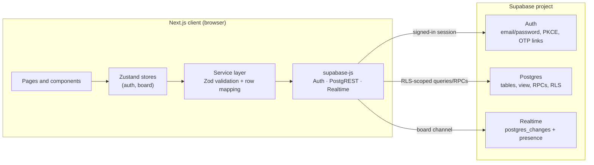

# Architecture

Flowboard is a collaborative kanban app built as a **single Next.js 15 App Router client** that talks directly to **Supabase** for authentication, Postgres storage, Row Level Security, and Realtime updates. There is no custom API server, no privileged server code, and no MongoDB or Socket.io layer.

The browser holds only the Supabase project URL and a **publishable / anon** key. Every read and write runs as the signed-in user and is enforced by Postgres RLS.

## Runtime layers

| Layer | Location | Responsibility |
|---|---|---|
| Routes and layouts | `src/app/` | Next.js App Router entry points, metadata, global CSS, auth guards |
| Feature components | `src/components/{auth,board,dashboard,layout}/` | Screens and feature UI |
| Design system | `src/components/ui/` | Reusable primitives: Button, Field, Modal, Drawer, Popover, Toast, etc. |
| Providers | `src/components/providers/` | Session bootstrap and app-wide providers |
| Hooks | `src/hooks/{animations,auth,ui}/` | Reusable client behavior grouped by concern |
| Stores | `src/stores/` | Zustand state, optimistic mutations, rollback, Realtime subscriptions |
| Services | `src/services/` | The only layer that calls Supabase; validates input and maps rows |
| Row mapping | `src/services/mappers.ts` | snake_case database rows → camelCase domain models |
| PostgREST helpers | `src/services/postgrest.ts` | Unwrap/throw conventions for Supabase results |
| Utilities | `src/lib/` | Pure helpers: dates, errors, navigation, reorder math, scroll lock, validation |
| Supabase client | `src/lib/supabase/` | Environment access and the browser singleton |
| Static config and seed data | `src/config/` | Board templates and presentation tokens |
| Types | `src/types/` | Domain models, database row types, ambient declarations |
| Database | `supabase/migrations/` | Tables, constraints, RLS, RPCs, Realtime publication |

## Data flow

- **Pages** are client components; dashboard and board data are loaded after the auth session is restored.
- **Stores** own UI state, optimistic mutations, rollback, and Realtime subscriptions.
- **Services** are the only place that calls Supabase. They validate input, map snake_case rows to domain types, and translate errors.
- **RLS is the security boundary.** Hiding a button is UX, not authorization.

## Why there is no API layer

There is intentionally no `src/app/api` directory. The project requirement is a frontend-only app with Supabase as the backend:

- The browser uses the publishable key, which is safe to ship.
- Authorization is expressed in RLS policies and narrowly scoped RPCs, not in server routes.
- No `service_role` key, database password, or privileged operation exists in client code.
- Atomic multi-table operations (board creation, card moves, list reordering, invites) live in Postgres functions so partial writes cannot occur from the client.

If a future feature truly needs a server-only secret, add it under `src/app/api` (or a Supabase Edge Function) and keep the secret server-side. Do not move privileged logic into the browser.

## Feature map

### Authentication

- Email/password registration and login through Supabase Auth.
- Optional email confirmation; unconfirmed accounts get a resend action and a clear message.
- Forgot-password and reset-password flows using Supabase email links and PKCE.
- `/auth/callback` supports `token_hash`, PKCE `code`, and already-detected sessions.
- Session persistence and automatic token refresh via the Supabase SDK.
- Profile display-name editing; board activity uses the stored profile name.
- Auth bootstrap with a friendly "Supabase not configured" screen instead of a broken UI.

### Dashboard

- Live portfolio stats: boards, lists, cards, due today, overdue, collaborators.
- Priority mix visualization with high/medium/low/no-priority buckets.
- Upcoming due cards across all accessible boards.
- Search by title/description, owned/shared filter, sort by updated/created/title, grid/list views.
- Create boards from six templates, rename/recolor/edit, delete (owner), leave (member).
- Manual refresh, loading skeletons, empty states, and per-action error handling.

### Board

- Board header showing description, card/list counts, online collaborators, Realtime connection state.
- Debounced search plus priority and assignee filters, with a live visible/total count and clear action.
- Lists: create, inline rename, move left/right, drag-to-reorder, delete with card-count confirmation.
- Cards: create inline, open detail modal, delete, drag within and across lists with visual drop indicators.
- Card fields: title, description, list, assignee, due date, priority, label (including custom labels).
- Members modal: invite an existing account by email, remove members (owner), leave board (member).
- Activity drawer grouped by day with action icons and relative timestamps.
- Board settings (owner only), copy link, refresh, delete board.
- Realtime `postgres_changes` for boards, lists, cards, members, and activity, plus presence.
- Optimistic UI with rollback on failed writes; automatic resync after reconnect.

### UX, accessibility, and motion

- Accessible modal/drawer stack: focus trap, Escape handling, focus restore, ref-counted background scroll lock.
- `aria-pressed`, `aria-live`, labelled icon buttons, visible focus rings, semantic headings.
- Reduced-motion support for CSS transitions and GSAP animations.
- Loading skeletons, empty states, toast feedback, inline validation, and dismissible error alerts.
- Responsive layout from mobile to wide desktop; horizontally scrollable kanban with contained overscroll.
- Copy is explicit about permissions, destructive actions, and realtime connection state.
