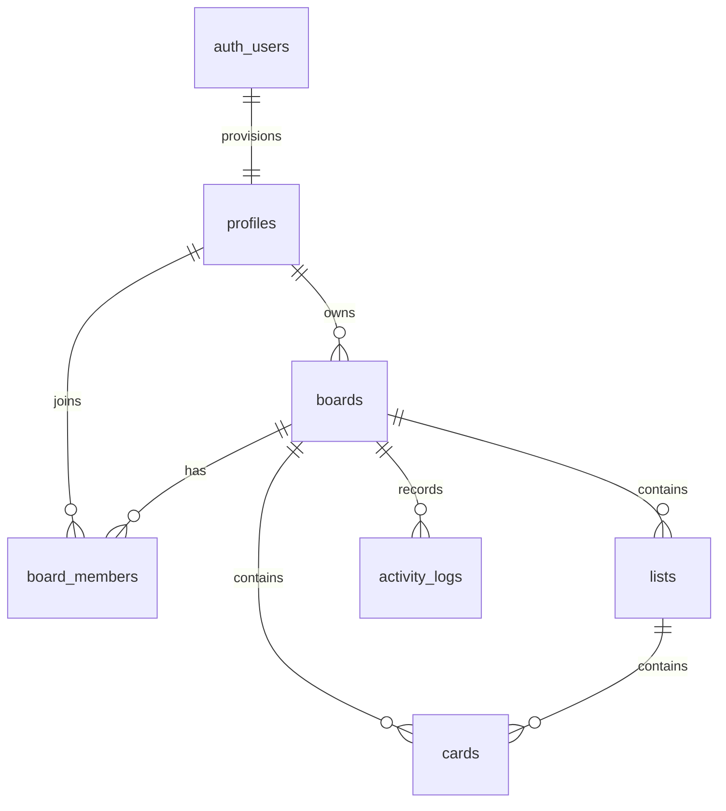

# Database and security

Flowboard uses Supabase Postgres directly. There is no custom server and no `service_role` key in the application.

## Supabase setup

### 1. Create a project

Create a project at [database.new](https://database.new) and keep the project URL and **publishable** key (or legacy anon key) available.

### 2. Apply migrations

Run the files in `supabase/migrations/` **in filename order**:

1. `20261026000100_schema.sql`
2. `20261026000200_rls.sql`
3. `20261026000300_functions.sql`
4. `20261026000400_realtime.sql`
5. `20261026000500_backfill_profiles.sql` — repairs auth users that existed before the sign-up trigger; without a profile row, board creation fails with a foreign-key error.

Using the Supabase SQL editor: open each file, paste its contents, and run it before moving to the next.

Using the Supabase CLI: link or initialize the project, then push the migrations (`supabase link --project-ref <ref>` followed by `supabase db push`).

The RLS migration grants table access only to `authenticated` and revokes `anon`. If your project restricts Data API exposure, make sure these public tables are exposed to the `authenticated` role.

### 3. Configure Auth

In **Authentication → URL Configuration**:

- **Site URL:** your app origin, e.g. `http://localhost:3000`.
- **Redirect URLs:** include `http://localhost:3000/auth/callback` and the production equivalent. Add extra local ports if you run on `3001`.

In **Authentication → Providers → Email**:

- Enable email/password.
- Choose whether email confirmation is required. If enabled, configure the confirmation email template and redirect link.
- Configure the recovery email template for password resets.

### 4. Verify Realtime

The Realtime migration adds `boards`, `board_members`, `lists`, `cards`, and `activity_logs` to the `supabase_realtime` publication. In the hosted dashboard, check **Database → Publications** if the publication did not exist when the migration ran. Postgres Changes still enforces RLS for every subscriber.

### 5. Environment variables

Copy `.env.example` to `.env.local`:

```bash
cp .env.example .env.local
```

```dotenv
NEXT_PUBLIC_SUPABASE_URL=https://your-project-ref.supabase.co
NEXT_PUBLIC_SUPABASE_PUBLISHABLE_KEY=sb_publishable_xxx
NEXT_PUBLIC_APP_URL=http://localhost:3000
```

| Variable | Required | Purpose |
|---|---|---|
| `NEXT_PUBLIC_SUPABASE_URL` | Yes | Supabase project URL |
| `NEXT_PUBLIC_SUPABASE_PUBLISHABLE_KEY` | Yes* | Publishable key (`sb_publishable_…`); browser-safe |
| `NEXT_PUBLIC_SUPABASE_ANON_KEY` | Yes* | Legacy anon key alternative; read first if both key names are set |
| `NEXT_PUBLIC_APP_URL` | Recommended | Origin used in confirmation and recovery redirects; defaults to the browser origin |

\* Set exactly one of `NEXT_PUBLIC_SUPABASE_PUBLISHABLE_KEY` or `NEXT_PUBLIC_SUPABASE_ANON_KEY`.

There are no server-only secrets and no `service_role` key. `NEXT_PUBLIC_*` values are embedded at build time, so rebuild after changing them in production.

## Data model



| Object | Purpose |
|---|---|
| `profiles` | Public display name for each `auth.users` row, provisioned by trigger |
| `boards` | Title, description, color, template, owner |
| `board_members` | `(board_id, user_id)` membership with `owner` / `member` role |
| `lists` | Ordered columns inside a board |
| `cards` | Ordered cards with priority, due date, label, assignee and denormalized `board_id` |
| `activity_logs` | Append-only board history with actor name snapshot |
| `board_overview` | `security_invoker` view aggregating counts and priority buckets per board |

### RPCs and triggers

| Function | Behavior |
|---|---|
| `create_board_from_template` | Creates the board, owner membership, template lists, and cards atomically; security invoker |
| `move_card` | Moves a card across lists and keeps source/destination positions contiguous atomically |
| `reorder_lists` | Reassigns list positions atomically after a drag |
| `invite_board_member` | Owner-only `SECURITY DEFINER` function; adds an **existing registered account** by email and returns `invited`, `already_member`, or `not_found` |
| `handle_new_user` | Creates the profile row when an auth user signs up |

## Security model

- **No privileged client code.** The browser uses only the publishable/anon key. All privileged behavior is expressed in Postgres RLS and narrowly scoped RPCs.
- **RLS on every public table.** Access derives from `auth.uid()`, board ownership, or `board_members`.
- **Private helpers.** `private.is_board_member`, `private.is_board_owner`, and `private.shares_board_with` are `SECURITY DEFINER`, pin `search_path`, revoke `public`/`anon`, and grant execute to `authenticated` only.
- **Least privilege.** `anon` has no table access. `activity_logs` is select/insert only for members; clients cannot update or delete history.
- **Owner controls.** Only owners can update/delete a board, invite members, or remove other members. Members can leave themselves.
- **View safety.** `board_overview` uses `security_invoker = true`, so a view cannot bypass RLS.
- **Realtime.** Postgres Changes broadcasts are filtered by RLS for each subscriber. The board channel uses the signed-in user's presence metadata only.
- **Validation.** Zod validates forms and service inputs for clear errors; database constraints and policies remain authoritative.
- **Error handling.** Internal Postgres messages are mapped to safe user-facing messages, so policy/schema details are not surfaced.
- **Auth.** Supabase handles hashing, sessions, refresh, confirmation, and recovery. PKCE is enabled and redirects are allowlisted in the Supabase dashboard.

### Presence privacy note

Postgres Changes are RLS-protected, but the Realtime **presence** channel is a public Supabase channel. Its payload contains only user id, display name, and join time, and board UUIDs are not enumerable, but a stricter deployment can switch to private Realtime channels with Realtime Authorization policies on `realtime.messages`. This is listed as remaining hardening work.

## Mock data policy

There is no mock data layer and no demo mode in this application. Every board, list, card, member, and activity entry shown while configured is read from Supabase. The six templates in `src/config/templates.ts` are deterministic **seed definitions**: creating a board writes their content into the live database as real rows. When Supabase is not configured, the UI explicitly displays setup instructions and does not pretend to load or save data.

## Operational note: pre-trigger accounts

`public.boards.owner_id` references `public.profiles`, and profiles are provisioned by the `on_auth_user_created` trigger. Auth accounts created before that trigger existed have no profile row and cannot create boards. Migration `20261026000500_backfill_profiles.sql` repairs them and is idempotent. Run it against any project that already contains auth users from an earlier setup.
